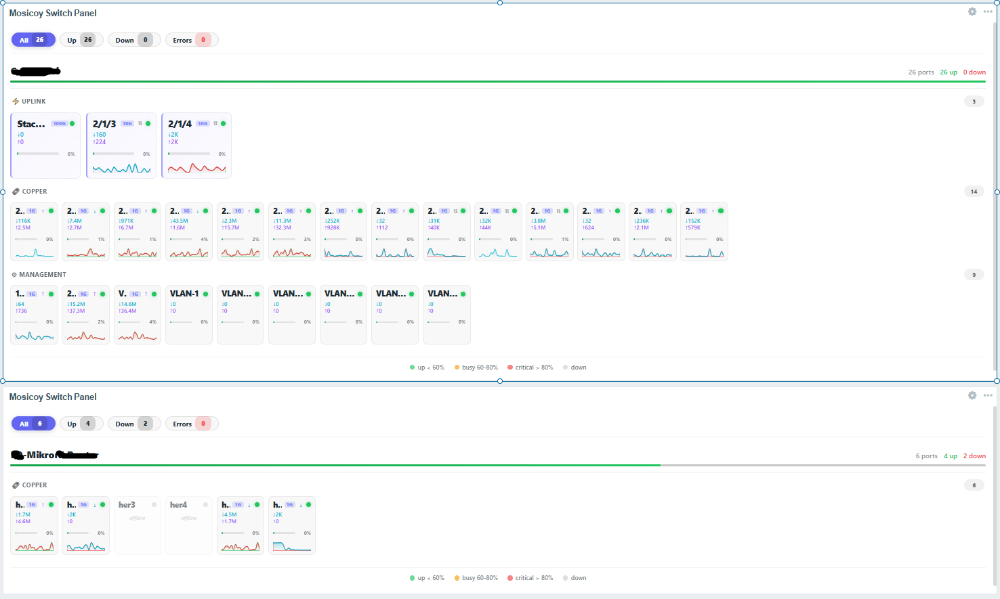
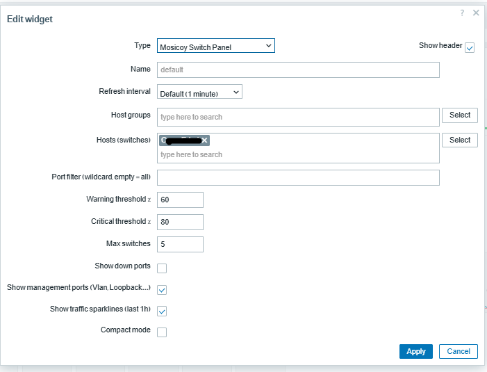

# Mosicoy Zabbix Widgets

A modern, beautiful widget collection for Zabbix 7.0 — built by a Network Engineer, for Network Engineers.

**Languages:** [English](README.md) | [Deutsch](README.de.md) | [Persian](README.fa.md)

## What is this?

14 modern, enterprise-grade widgets for Zabbix 7.0 — designed to make your dashboards look like Grafana, Datadog, or modern NOC tools, without leaving Zabbix.

Every widget:
- Beautiful by default
- Fast (minimal API calls, smart batching)
- Safe (try/catch everywhere, never white-screens)
- Easy to configure
- Dark/Light aware
- Responsive

## Why I built this

As a Network Engineer working in NOC environments, I kept hitting the same wall: Zabbix is powerful, but its dashboards look like 2010. So I built it myself.

## The 14 Widgets

### Data and Analytics
- Calendar Heatmap
- KPI Wallboard
- Heatmap Matrix

### Network Monitoring
- Switch Panel
- Top Talkers
- Interface Errors
- Network Map

### Status and Problems
- Status Grid
- Problem Timeline
- Sankey Flow
- Gauge Cluster

### Comparison
- Radar Compare
- Network Topology

### Routing (Preview)
- Routing Monitor

---

## 📸 Screenshots

  
  
<em>Switch Panel — Visual port monitoring with sparklines and error badges</em>

### Calendar Heatmap

| | |
|---|---|
|  |  |

### Status Grid

| | |
|---|---|
|  |  |

### Gauge Cluster

| | |
|---|---|
|  |  |

### KPI Wallboard

| | |
|---|---|
|  |  |

### Heatmap Matrix

| | |
|---|---|
|  |  |

### Problem Timeline

### Sankey Flow

| | |
|---|---|
|  |  |

### Radar Compare

| | |
|---|---|
|  |  |

### Network Topology

| | |
|---|---|
|  |  |

### Switch Panel

| | |
|---|---|
|  |  |

### Top Talkers

| | |
|---|---|
|  |  |

### Interface Errors

| | |
|---|---|
|  |  |

### Routing Monitor

| | |
|---|---|
|  |  |

---

## ⚡ Quick Install

1. Download the release ZIP
2. Extract to `/usr/share/zabbix/modules/`
3. In Zabbix: **Administration → General → Modules → Scan directory**
4. Enable the widgets you want

## 🎨 Color Themes

6 palettes per widget: Default, Zabbix, Pastel, Bright, Dark, Blue Mono.

## 🧪 Tested On

- Zabbix 7.0 on Ubuntu 22.04 and 24.04
- Cisco IOS Catalyst via Cisco IOS by SNMP
- MikroTik RouterOS via MikroTik by SNMP

## 👨‍💻 Author

**Mostafa Shorgashti** — Network and Security Engineer

- 📧 Email: m.shorgashti@gmail.com
- 🐙 GitHub: https://github.com/Mostafa65sh
- 💼 LinkedIn: https://linkedin.com/in/mostafashorgashti
- 🌐 Website: https://2ping.ir | https://livekadeh.com
- 🏢 Company: Mosicoy

## 📜 License

MIT — see [LICENSE](LICENSE) file.

---

**Made with ❤️ by Mostafa Shorgashti**

⭐ Star this repo if you find it useful!

